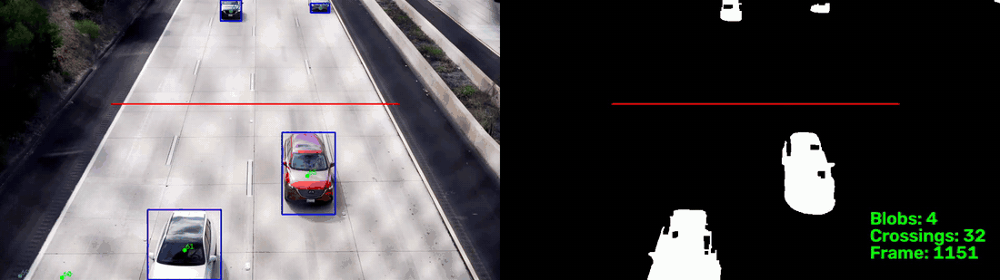
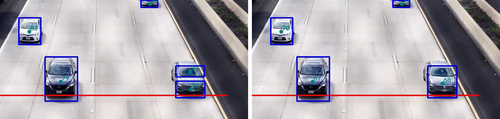

# Traffic Flow Estimator

Estimating traffic flow from single fixed-camera video using classical (non-deep-learning) computer vision — background subtraction, connected-components blob detection, and centroid tracking, with the core data structures implemented from scratch.

Built as an Honors Contract project for CISC187 (Data Structures, C++).



*The pipeline on my own footage of I-5 near UCSD (6 s, frames 1150–1510). Left: video frame with each vehicle's box, track ID and centroid, and the count line in red. Right: the cleaned foreground mask the blobs come from, with the running crossing count.*

## Why classical CV, not a detector?

The point of the project is the data structures, not the detections. Rather than dropping in an off-the-shelf object detector, vehicles are found and tracked with hand-implemented algorithms built on top of OpenCV's lower-level primitives (background subtraction, video I/O, basic image ops).

## Pipeline

Each frame goes through these stages (`src/main.cpp`). The parts marked **from scratch** are my own implementations, each with a standalone check program in `scratch/`:

1. **Background subtraction:** OpenCV `BackgroundSubtractorMOG2` with a fixed, slow learning rate, which cut vehicle fragmentation compared with the automatic rate. Shadow pixels are thresholded out, then a morphological open (3×3) and close (7×7) clean up the mask.
2. **Connected-components labeling (from scratch, BFS):** `src/ccl.*` labels the binary mask with 4- or 8-connectivity and returns each blob's bounding box, area and centroid. Checked against `cv::connectedComponentsWithStats` frame by frame: 0 mismatches at both connectivities.
3. **Area filter:** drops blobs below a minimum size (noise, specks).
4. **Non-max suppression (from scratch, binary heap):** `src/heap.*` is a max-heap of blobs ranked by area, built in O(n) with bottom-up sift-down; `src/nms.*` pops it largest first and drops any blob whose IoU with a kept blob is over 0.5. Tested against a sorted reference and `std::priority_queue` (233,800 pops) and against randomized property checks.
5. **Fragment grouping (from scratch, union-find):** `src/unionfind.*` (path compression + union by rank) and `src/group.*` merge blobs that are fragments of one vehicle: two blobs are united when their horizontal extents overlap by at least 50% of the narrower box and the vertical gap between them is at most 10 px, so fragments in the same lane join and cars in adjacent lanes stay apart. Each group becomes one box with an area-weighted centroid. Tested against a brute-force reference (804,000 unions) and on the real boxes from the observed double counts.
6. **Tracking and counting:** `src/tracker.*` matches blobs to tracks greedily, nearest first, within a distance gate. A track is confirmed after 3 hits and dropped after 5 misses, and it is counted once when its centroid changes sides of the clip's count line (defined per clip in `source-videos/meta.json`). Frames during MOG2's warm-up are not counted.

The output is a total count, an optional CSV of crossing events (`clip,frame,track_id,x`), and in interactive mode a side-by-side view of the frame and mask with boxes, track IDs, the count line and running counters.

Headless at half resolution (960×540), the whole pipeline runs at about 6–8 ms per frame on a laptop, well within real time for 60 fps video.

## Status

*Last updated Nov 9, 2026. Target finish: Dec 2, 2026.*

- **Done:** the full pipeline above, end to end, on Windows and macOS. Hand-counted ground truth for two clips, a grading script, and an error analysis that led to the fragment-grouping stage.
- **Next:** ground truth for the two remaining validation clips (a wider phone framing of the same road, and the opposite direction with 5 lanes), which have not been used for any tuning; then the stretch goals below and a formal write-up.

### Stretch goals
- Ring buffer of recent centroids per track: velocity estimates (pixels/frame) and position prediction for missed frames
- Speed in world units (needs pixel↔world calibration) and per-lane counts
- KD-tree for nearest-neighbor matching (likely unnecessary at under 10 blobs per frame; may be kept as a scaling comparison instead)

## Tech stack

- C++17, g++ (MinGW-w64 on Windows, Apple clang on macOS)
- OpenCV 5.0.0 (video I/O, background subtraction, basic preprocessing)
- GNU Make + pkg-config

## Setup

The build works on Windows (MSYS2) and macOS (Homebrew). The `Makefile` gets OpenCV's include and library paths from `pkg-config opencv5`, so the same file works on both.

### Windows (MSYS2 UCRT64)

1. Install [MSYS2](https://www.msys2.org/) and open the **UCRT64** terminal.
2. Install the toolchain, OpenCV, and Qt6:
   ```sh
   pacman -S make mingw-w64-ucrt-x86_64-gcc mingw-w64-ucrt-x86_64-pkgconf \
             mingw-w64-ucrt-x86_64-opencv mingw-w64-ucrt-x86_64-qt6-5compat
   ```
   pacman lists Qt6 as optional, but MSYS2's HighGUI (`imshow`) is built on Qt6. Without it, executables exit silently with code 127 (missing DLLs).
3. To run executables outside the UCRT64 terminal, add `C:\msys64\ucrt64\bin` to the Windows `PATH`. From Git Bash, add `/c/msys64/ucrt64/bin` instead.

### macOS (Homebrew)

1. Install the Xcode command-line tools (`xcode-select --install`) and [Homebrew](https://brew.sh/). `g++` on macOS is Apple clang, which supports C++17.
2. Install OpenCV:
   ```sh
   brew install openssl@4   # install first, see note below
   brew install opencv
   ```
   pkg-config comes in as a dependency. HighGUI uses the native macOS windowing, so you don't need extra setup for `imshow`.

   > **Note (Homebrew 7.0.9, Oct 2026):** a plain `brew install opencv` can fail with *"A `brew install opencv` process has already locked /opt/homebrew/Cellar/openssl@3"*. No other brew process is involved: opencv's dependency tree includes both `openssl@3` and `openssl@4`, and installing `openssl@4` makes brew re-lock `openssl@3`, which is already locked. Installing `openssl@4` on its own first avoids this. If an install was interrupted, run `brew reinstall openssl@4` and then `brew install opencv`.

### Check the install

```sh
pkg-config --modversion opencv5          # should print 5.0.0
make build/hello_opencv.exe && build/hello_opencv.exe
```

A small window saying "it works" should appear. Press any key to close it.

### Build and run

```sh
make                                     # builds build/main.exe
build/main.exe --video_path source-videos/ucsd-i5-incoming-stabilized-boosted-dslr.mp4 --scale 0.5
```

- The clip needs an entry with a `count_line` in `source-videos/meta.json` (matched by file name).
- `--scale <s>` (`0 < s <= 1`) downscales frames before processing. At 1.0, the side-by-side display is 3840 px wide, so use 0.5 when watching interactively.
- `--headless` skips all display, for timing runs.
- `--kneighbors <4|8>` picks the blob-labeling connectivity (default 4).
- `--event_out <path>` writes one CSV row per counted crossing (`clip,frame,track_id,x`), the input to `scratch/grade.py`.
- Every run prints `Crossings: N` at the end.
- While the window is open: space pauses and resumes; `.` or `k` steps one frame while paused; `q`/Esc quits.
- The `.exe` suffix is kept on macOS too, so targets and commands match on both platforms.

### VS Code build shortcut (optional)

`.vscode/` is gitignored, so each machine needs its own `tasks.json`: a `shell` task running `make` in `${workspaceFolder}`, marked as the default build task (`"group": {"kind": "build", "isDefault": true}`), with `"problemMatcher": ["$gcc"]`.

- **Windows:** run it through MSYS2 bash, with `options.shell.executable` set to `C:\msys64\usr\bin\bash.exe`, args `["--login", "-c"]`, and env `MSYSTEM=UCRT64`, `CHERE_INVOKING=1`. Shortcut: Ctrl+Shift+B.
- **macOS:** plain `make` is enough. Prepend `/opt/homebrew/bin` to `PATH` in `options.env`, so pkg-config is found even when VS Code isn't launched from a terminal. Shortcut: Cmd+Shift+B.

## Data

Source footage is fixed-camera traffic video: the author's own recordings from an I-5 overpass and a city street, plus clips from [Pexels](https://www.pexels.com/) downloaded by hand. Each clip was checked for camera motion, since background subtraction needs a static camera; the own recordings were stabilized in software first. Per-clip metadata (source, resolution/fps, stability, role, count line) lives in `source-videos/meta.json`: the main clip is `ucsd-i5-incoming-dslr`, the validation clips are `ucsd-i5-incoming-dslr2`, `ucsd-i5-incoming` and `ucsd-i5-outgoing` (all shot the same day from the same overpass; the last one faces the opposite direction), and the backup is `urban-road`. Until Oct 31 the main and validation clips were the Pexels clips `auckland-hwy` and `auckland-fwy`.

Pexels clips are used under the [Pexels License](https://www.pexels.com/license/) (free to use and modify, no attribution required, no redistributing unaltered copies). No raw video is checked into this repo (see `.gitignore`).

## Benchmark

**Ground truth.** For each graded clip, I stepped through the video frame by frame and recorded every vehicle whose middle crosses the count line (frame, lane, size class) in `ground-truth/<clip>.csv`. The same counting rules apply to every clip.

**Grading.** `scratch/grade.py` matches pipeline crossing events to ground-truth rows one-to-one within ±15 frames (0.25 s at 60 fps). It reports true positives, misses and false counts, and plots the timeline and timing offsets.

**Results** (`--scale 0.5`, current `main`):

| Clip | Role | Ground truth | Before grouping | After grouping |
|---|---|---|---|---|
| `ucsd-i5-incoming-dslr` | main (tuning) | 71 | 73 counted, 2 false | **71 counted, 0 false, 0 missed** |
| `ucsd-i5-incoming-dslr2` | validation | 65 | 66 counted, 1 false | **65 counted, 0 false, 0 missed** |

Pipeline crossings land a median of 2 frames before the human mark.

**What the errors were.** I stepped through every disagreement in the first grade. Two turned out to be ground-truth mistakes (a car missed at the very end of one clip, and a row with no car on the other), which I corrected. Every real error was the same kind: **one vehicle split into two blobs** in the foreground mask (a car, a maintenance truck, an SUV whose roof rack separated), which the tracker then counted twice.



*Frame 1203 of `ucsd-i5-incoming-dslr`, without (left) and with (right) union-find grouping. Without it, the silver car's roof and front end separate in the mask, the car becomes two blobs with two tracks, and both get counted as they cross the red line. With grouping, the two fragments are merged into one box and one track.*

There were no merged vehicles and no lost-and-respawned tracks on this footage. So I skipped the blob-splitting approaches I had planned (watershed, track-seeded BFS) and added the union-find grouping stage instead.

**Caveats.** Both graded clips were shot on the same day from the same overpass, and the grouping thresholds were sized using the fragment boxes from both clips' errors, so `-dslr2` is not a fully held-out test for that stage. The two remaining validation clips (`ucsd-i5-incoming`, `ucsd-i5-outgoing`) were not used for any tuning and are the next thing to count. The grouping gap is in processing-scale pixels, so it is only calibrated for `--scale 0.5`.

## Repository layout

| Path | Contents |
|---|---|
| `src/` | The pipeline: `main.cpp` (frame loop, display, controls), `args.*` (CLI), `ccl.*` (BFS labeling), `heap.*` + `nms.*` (heap NMS), `unionfind.*` + `group.*` (fragment grouping), `tracker.*`, `meta.*` (clip metadata) |
| `scratch/` | Check programs (`ccl_check`, `heap_check`, `nms_check`, `unionfind_check`, `group_check`), tuning and diagnostic tools (`mog2_tune`, `warmup_check`, `blob_dump`, `frame_grid`, `make_demo`), `grade.py`, `stabilize.py` |
| `ground-truth/` | Hand-counted crossings per clip |
| `docs/media/` | README images, rendered with `scratch/make_demo` |
| `source-videos/meta.json` | Per-clip metadata: source, resolution, stability, role, count line, ground-truth file |
| `reports/`, `PROGRESS_LOG.md`, `log.md` | Weekly progress reports and working notes |
